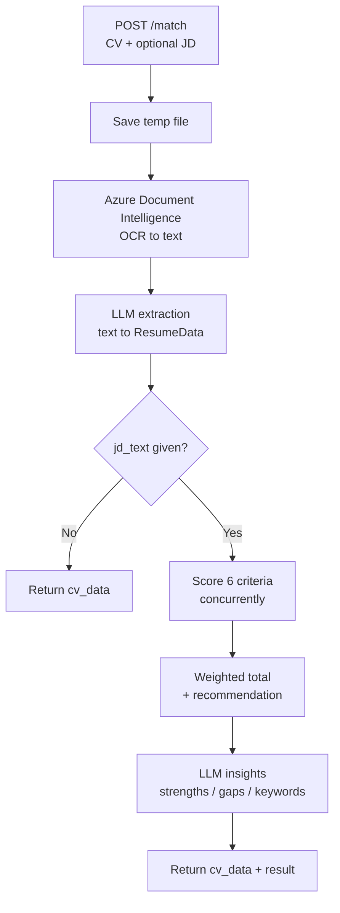

# CV Matching API

[](https://www.python.org/downloads/)
[](https://fastapi.tiangolo.com/)
[](https://www.docker.com/)
[](https://blog.cleancoder.com/uncle-bob/2012/08/13/the-clean-architecture.html)

Reads a candidate CV into structured data and, when given a job description, scores the candidate
against it on six weighted criteria — returning a 0–100 match score, a SHORTLIST / REVIEW_CAREFULLY /
REJECT recommendation, and the evidence behind both.

Every number the API returns is explained: each criterion carries its own score, weight and written
justification, so a recruiter can see *why* a candidate ranked where they did rather than being handed
an opaque total.

> Extracted from the `ai_erp_backend` monorepo, where it ran as the `cv_matching` service. The HTTP
> contract is unchanged — see [Migration notes](#migration-notes).

## Contents

- [What it does](#what-it-does)
- [Scoring criteria](#scoring-criteria)
- [Quick start](#quick-start)
- [Configuration](#configuration)
- [API reference](#api-reference)
- [Architecture](#architecture)
- [Testing](#testing)
- [Deployment](#deployment)
- [Migration notes](#migration-notes)

## What it does

One endpoint, two modes:

| Request | What happens | Response |
| --- | --- | --- |
| CV only | The CV is OCR'd and parsed into structured resume data | `cv_data` filled, `result` is `null` |
| CV + `jd_text` | The above, then six criteria are scored concurrently and summarised | `cv_data` and `result` both filled |

Sending a CV without a job description is a complete request, not a degraded one — extraction is a
useful answer on its own, and skipping the scoring avoids paying for seven LLM calls that would have
nothing to compare against.

## Scoring criteria

Six criteria, scored independently and combined into a weighted total:

| Criterion | Key | Default weight |
| --- | --- | ---: |
| Skills | `skills` | 40% |
| Relevant Project Count | `relevant_project_count` | 25% |
| Years of Experience | `years_of_experience` | 15% |
| Background (University) | `background` | 10% |
| Title/Role | `title_role` | 10% |
| Location | `location` | 0% |

Callers can override any subset via the `weights` form field; untouched criteria keep their defaults
and the whole set is rescaled to total 100%, so `match_score` stays on a 0–100 scale.

**Why Location is weighted 0.** Measured across 50 CVs over 10 JDs it scored an AUC of 0.41–0.53 on six
different models — it does not move when the JD changes, because every posting was a Vietnam-based role
and every candidate was in Vietnam. What it did do was award a flat 100 to 85% of candidates and a 0 to
whoever left an address off their CV, which measures CV formatting rather than fit. It is still scored
and reported so a recruiter can see it; it just no longer moves the total. Teams hiring across regions
can weight it back up through `weights`.

Location still has teeth where it matters: a genuine on-site conflict — the JD requires a named
location, the candidate is elsewhere, and nothing suggests they would relocate — blocks an automatic
SHORTLIST, downgrading it to REVIEW_CAREFULLY with a warning that says why.

**Recommendation thresholds:** `>= 70` SHORTLIST · `>= 40` REVIEW_CAREFULLY · otherwise REJECT.

## Quick start

### Requirements

- Python 3.10+ (3.13 recommended, matching the container)
- Azure Document Intelligence credentials
- A LiteLLM-compatible endpoint and key

### Run locally

```bash
git clone https://github.com/vietld-3584/CV-Matching.git
cd CV-Matching

cp .env.example .env      # then fill in the credentials

uv venv && uv pip install -e ".[dev]"
uv run uvicorn main:app --reload --port 8000
```

Interactive docs at <http://localhost:8000/docs>, health at
<http://localhost:8000/cv-matching/health>.

### Run with Docker

```bash
cp .env.example .env      # then fill in the credentials
docker compose up --build
```

## Configuration

All configuration is environment variables, validated at startup — a missing credential fails the
process rather than the first request that needs it.

| Variable | Required | Default | Purpose |
| --- | :---: | --- | --- |
| `AZURE__ENDPOINT` | ✅ | — | Azure Document Intelligence endpoint |
| `AZURE__KEY` | ✅ | — | Azure Document Intelligence key |
| `AZURE__REGION` | | `japaneast` | Sent as the `x-ms-region` header |
| `CV_MATCHING_LITELLM__URL` | ✅ | — | LiteLLM base URL |
| `CV_MATCHING_LITELLM__API_KEY` | ✅ | — | LiteLLM API key |
| `CV_MATCHING_LITELLM__MODEL` | | `gemini-3.1-flash-lite-preview` | Model used for extraction and scoring |
| `CV_MATCHING_LITELLM__TIMEOUT` | | `90` | Per-call timeout, seconds |
| `CV_MATCHING_LITELLM__MAX_RETRIES` | | `2` | Retries per LLM call (0–5) |
| `CV_MATCHING_LITELLM__REASONING_EFFORT` | | unset | When set, sent as `reasoning_effort` and temperature is dropped |
| `AUTH__API_KEY` | ✅ | — | Value clients must send as `X-API-Key` |
| `ROOT_PATH` | | `/ai` | Prefix the ingress strips before forwarding |
| `SERVICE_PREFIX` | | `/cv-matching` | Path the app serves under |
| `API_PREFIX` | | `/api/v1` | Versioned API prefix |

**On the model choice.** `gemini-3.1-flash-lite-preview` was the only model of six benchmarked that
returns an identical score when the same CV is re-scored, and it is 3× faster at p50 / 15× at p90 than
`gemini-3-flash-preview`, which also timed out on 10% of CVs. The 90s timeout sits under the proxy's
120s Cloudflare read cut-off, so a slow call surfaces as our own timeout — which `MAX_RETRIES` can act
on — rather than an opaque 524.

## API reference

All endpoints below are shown as served by the app. In deployment an ingress adds `ROOT_PATH` (`/ai`)
in front, so the public URL is `https://<host>/ai/cv-matching/api/v1/match`.

| Method | Path | Auth | Purpose |
| --- | --- | :---: | --- |
| `POST` | `/cv-matching/api/v1/match` | ✅ | Extract a CV, and match it against a JD when one is given |
| `GET` | `/cv-matching/health` | | Liveness |
| `GET` | `/cv-matching/ready` | | Readiness |
| `GET` | `/cv-matching/metrics` | | Prometheus metrics |

### `POST /cv-matching/api/v1/match`

`multipart/form-data`, authenticated with an `X-API-Key` header.

| Field | Type | Required | Description |
| --- | --- | :---: | --- |
| `file` | file | ✅ | CV to read — `pdf`, `docx`, `png`, `jpg`, `jpeg` |
| `jd_text` | string | | Job description. Omit to get extraction only |
| `weights` | string | | JSON object overriding criterion weights, e.g. `{"skills": 50, "location": 5}` |

**Extraction only:**

```bash
curl -X POST http://localhost:8000/cv-matching/api/v1/match \
  -H "X-API-Key: $AUTH_API_KEY" \
  -F "file=@candidate.pdf"
```

**Full match with custom weights:**

```bash
curl -X POST http://localhost:8000/cv-matching/api/v1/match \
  -H "X-API-Key: $AUTH_API_KEY" \
  -F "file=@candidate.pdf" \
  -F "jd_text=Senior Python engineer, 5+ years, FastAPI and AWS..." \
  -F 'weights={"skills": 50, "location": 10}'
```

**Response shape:**

```jsonc
{
  "success": true,
  "cv_data": {
    "name": "Nguyen Van A",
    "email": "a@example.com",
    "tags": ["HN", "hust"],
    "tech_skills": ["Python", "FastAPI", "PostgreSQL"],
    "education": [...],
    "working_experience": [...],
    "projects": [...]
  },
  "result": {
    "match_score": 78,
    "overall_summary": "Strong backend fit with directly relevant project work...",
    "criterion_scores": [
      {
        "criterion": "skills",
        "criterion_name": "Skills",
        "score": 85,
        "weight": 40.0,
        "weighted_score": 34.0,
        "explanation": "Has all required skills; missing only Kubernetes."
      }
      // ...five more
    ],
    "recommendation": "SHORTLIST",
    "recommendation_reason": "Strong overall match with good alignment across most criteria.",
    "strengths": [...],
    "areas_to_address": [...],
    "matched_keywords_and_skills": [...],
    "warnings": []
  },
  "warnings": []
}
```

`warnings` is non-empty when the analysis completed but something is worth flagging — no readable work
history, an on-site location conflict, or insights that could not be generated. A failure to produce
the narrative summary is downgraded to a warning rather than losing the scores, which are the substance
of the report and already computed by that point.

### Errors

| Status | When |
| ---: | --- |
| `400` | Unsupported file type, empty file, malformed `weights` JSON, unknown or negative criterion key |
| `401` | Missing or invalid `X-API-Key` |
| `404` | Uploaded file could not be found on disk |
| `422` | CV could not be parsed, or a criterion could not be scored |
| `500` | Unexpected internal error |

A misspelled criterion in `weights` is rejected rather than ignored — silently dropping it would return
a plausible-looking score computed from weights the caller never asked for.

## Architecture

Clean architecture, four layers, dependencies pointing inward:

```
cv_matching/src/
├── domain/                  # Business rules - no I/O, no framework
│   ├── entities/            # ResumeData, MatchingResult, Criterion, weights
│   ├── ports/               # IDocumentParser, ILLMService, IFileProcessor
│   └── services/            # CriterionScorers, resume_profile, AuthenticationService
├── application/             # Orchestration
│   ├── use_cases/           # MatchCvUseCase
│   └── dtos/                # Request/response models
├── infrastructure/          # External integrations
│   ├── adapters/            # AzureDocumentParser, LiteLLMService, FileProcessor
│   ├── config/              # Settings
│   └── container.py         # DI container
└── presentation/            # FastAPI routes and dependencies
```

Request flow:



The six criterion scorers share no state, so they run concurrently under `asyncio.gather` — one round
trip's latency instead of six. Each owns a focused prompt, so a criterion can be re-tuned without
disturbing the others.

## Testing

```bash
uv run pytest              # 38 tests
uv run ruff check .
uv run ruff format --check .
```

The suite covers weight resolution and rescaling, experience arithmetic (overlapping roles counted
once, undatable entries skipped), the projects section, prompt rendering, and the use-case's failure
handling. It uses fake LLM and parser doubles throughout, so it needs no credentials and no network.

## Deployment

**Container image** — multi-stage build published to Harbor via the `Build Image` workflow:

```bash
docker build -t cv-matching:local .
```

**Helm chart** in [`deploy/charts/cv-matching`](deploy/charts/cv-matching):

```bash
helm dependency build deploy/charts/cv-matching
helm upgrade --install cv-matching deploy/charts/cv-matching \
  --set azure.endpoint=... --set azure.key=... \
  --set litellm.apiKey=... --set auth.apiKey=...
```

Liveness probes `/cv-matching/health`, readiness probes `/cv-matching/ready`.

Secrets are supplied at deploy time — the chart ships empty defaults and nothing is baked into the
image.

## Migration notes

This service previously lived at `apps/cv_matching` in the `ai_erp_backend` monorepo.

- **The HTTP contract is unchanged.** The OpenAPI operation for `/match` and all 16 of its schemas are
  byte-identical to the monorepo's. Pointing the ingress at this service needs no client changes.
- **`/cv-matching/ready` is new** — added so the readiness probe has its own endpoint, separate from
  liveness.
- **Shared code was vendored, not imported.** `AzureDocumentParser`, `FileProcessor`,
  `AuthenticationService` and the `verify_api_key` dependency came from `doc_analyzer`. `FileProcessor`
  was reduced to the two methods this service actually calls, which drops `pdf2image`, `pillow`,
  `python-docx`, `pypdf2` and the `poppler-utils` system package — Azure DI reads PDF, DOCX and images
  directly, so nothing needed converting.
- **Environment variable names are unchanged** (`AZURE__*`, `CV_MATCHING_LITELLM__*`, `AUTH__API_KEY`),
  so existing secrets carry over as-is.

## License

Internal Sun* project. See [SECURITY.md](SECURITY.md) for vulnerability reporting and
[CONTRIBUTING.md](CONTRIBUTING.md) for contribution guidelines.
