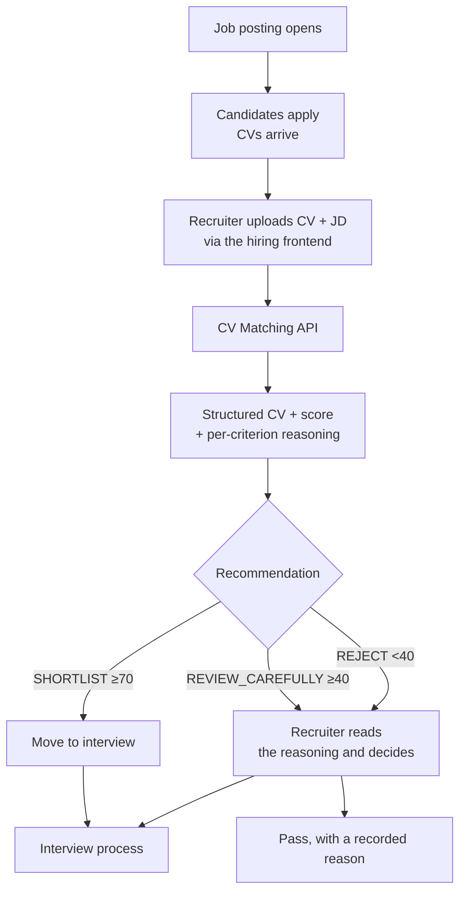
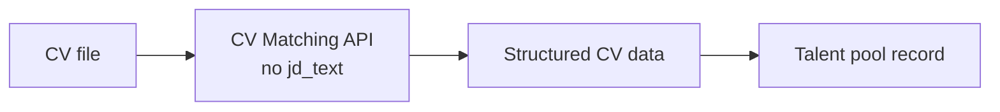

# Business Flow

> How the CV Matching service fits into the screening process. Background:
> [`project-overview.md`](./project-overview.md).

## 1. Screening flow

The recommendation is an input to a human decision, never a gate. Even a `REJECT` reaches a recruiter
with its per-criterion explanations attached — the point is to order and justify the queue, not to
close it.

## 2. Where the value lands

| Step | Before | With the service |
| --- | --- | --- |
| Reading a CV | Manual, minutes per candidate, formats vary | Seconds, normalised into one structure |
| Ranking | Recruiter judgement, varies by reader and by fatigue | Consistent weighted score, reproducible on re-run |
| Justification | Held in the recruiter's head | Per-criterion score, weight and written reason |
| Adjusting priorities | Re-read everything with new emphasis | Re-weight criteria per request |

## 3. Extraction-only flow

Uploading a CV without a job description returns just the structured data — used to populate a
candidate record when there is no specific posting to match against yet.

## 4. Revision history

| Date | Author | Change |
| --- | --- | --- |
| 2026-08-19 | Le Duc Viet | Initial version, extracted from the `ai_erp_backend` monorepo |
