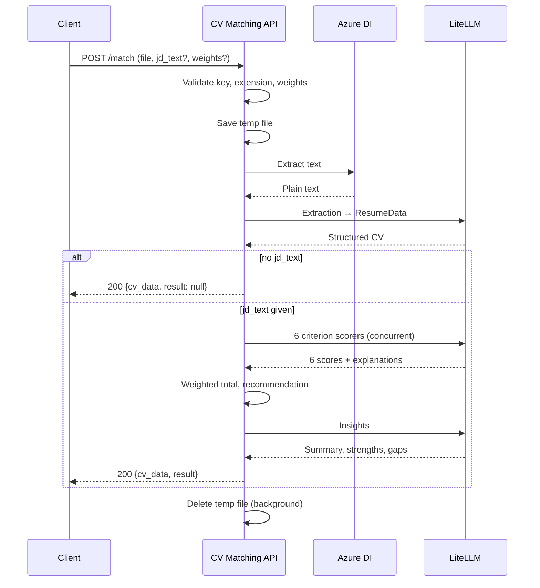

# API-001 — Extract and match a CV

> `POST /ai/cv-matching/api/v1/match`
> Index: [`api-list.md`](./api-list.md)

## 1. Summary

| Item | Value |
| --- | --- |
| ID | API-001 |
| Method / path | `POST /api/v1/match` |
| Authentication | `X-API-Key` header (required) |
| Request format | `multipart/form-data` |
| Response format | `application/json` |
| Typical latency | ~5–15s for a full match; ~3–5s for extraction only |

Reads a CV into structured data, and — when a job description is supplied — scores the candidate
against it on six weighted criteria.

**Two modes.** Without `jd_text` the request stops after extraction and returns `cv_data` with
`result: null`. This is a complete answer, not a partial one: with nothing to compare against, the
seven scoring calls would be paid for to produce nothing.

## 2. Request

| Field | Type | Required | Description |
| --- | --- | :---: | --- |
| `file` | file | ✅ | CV file. Allowed: `pdf`, `docx`, `png`, `jpg`, `jpeg` |
| `jd_text` | string | | Job description text. Omit for extraction only |
| `weights` | string (JSON) | | Overrides for criterion weights, e.g. `{"skills": 50, "location": 5}` |

### Weights

Keys are the `criterion` values returned in `criterion_scores`. Any criterion omitted keeps its
default weight, and the resulting set is rescaled to total 100% so `match_score` stays on a 0–100
scale. Only applied when `jd_text` is present.

| Criterion key | Display name | Default weight |
| --- | --- | ---: |
| `skills` | Skills | 40% |
| `relevant_project_count` | Relevant Project Count | 25% |
| `years_of_experience` | Years of Experience | 15% |
| `background` | Background (University) | 10% |
| `title_role` | Title/Role | 10% |
| `location` | Location | 0% |

Location defaults to 0% because it measured CV formatting rather than fit — see the rationale in the
[README](../../../README.md#scoring-criteria). It is still scored and reported, and a genuine on-site
conflict still downgrades a SHORTLIST.

An unknown or negative key is rejected with `400` rather than ignored: silently dropping it would
return a plausible score computed from weights the caller never asked for.

### Example

```bash
curl -X POST https://<host>/ai/cv-matching/api/v1/match \
  -H "X-API-Key: $AUTH_API_KEY" \
  -F "file=@candidate.pdf" \
  -F "jd_text=Senior Python engineer, 5+ years, FastAPI and AWS..." \
  -F 'weights={"skills": 50, "location": 10}'
```

## 3. Response — `200 OK`

| Field | Type | Description |
| --- | --- | --- |
| `success` | bool | Always `true` on a 200 |
| `cv_data` | object | Structured CV. Always present on success |
| `result` | object \| null | Matching result. `null` when no `jd_text` was given |
| `warnings` | string[] | Issues encountered; empty when everything succeeded |

### `cv_data`

| Field | Type | Description |
| --- | --- | --- |
| `name`, `email` | string | Falls back to `"Unknown"` / `"unknown@example.com"` when absent |
| `tags` | string[] | Location codes (HN, HCM, DN, JP) and university codes (hust, uit, fpt…); `["other"]` when nothing matches |
| `date_of_birth`, `phone_number`, `address` | string \| null | |
| `social_profile` | object[] | `{platform, url}` |
| `tech_skills`, `non_tech_skills` | string[] | |
| `languages` | object[] | `{language, proficiency}` |
| `education` | object[] | `{institution, degree, field, start_date, end_date, gpa, description}` |
| `working_experience` | object[] | `{company, position, start_date, end_date, location, description, achievements[]}` |
| `projects` | object[] | `{name, role, description, tech_stack[], start_date, end_date, team_size, customer}` |

`projects` is extracted separately from `working_experience` on purpose: Vietnamese developer CVs
routinely put their strongest evidence — client, team size, tech stack per project — in a dedicated
projects section, and folding it into the job history loses what the scoring most needs.

### `result`

| Field | Type | Description |
| --- | --- | --- |
| `match_score` | int 0–100 | Weighted sum of the six criterion scores |
| `overall_summary` | string | Narrative assessment of fit |
| `criterion_scores` | object[] | One per criterion: `{criterion, criterion_name, score, weight, weighted_score, explanation}` |
| `recommendation` | enum | `SHORTLIST` (≥70) · `REVIEW_CAREFULLY` (≥40) · `REJECT` |
| `recommendation_reason` | string \| null | Why that recommendation |
| `strengths` | object[] | `{title, description, keywords[]}` |
| `areas_to_address` | object[] | `{title, description, suggestions_for_improvement, keywords[]}` |
| `matched_keywords_and_skills` | object[] | `{keyword, resume_presence, job_description_presence, relevance_score}` |
| `warnings` | string[] | Same content as the top-level `warnings` |

### Warnings

A `200` with a non-empty `warnings` means the analysis completed but something is worth flagging:

| Warning | Meaning |
| --- | --- |
| `No work experience could be read from the CV.` | Extraction found no job history — a fresher, or a CV layout that did not parse |
| `On-site role in X, but the candidate appears to be in Y…` | On-site conflict. Also downgrades SHORTLIST → REVIEW_CAREFULLY |
| `Could not generate detailed insights due to an LLM error.` | Scores are valid; `strengths` / `areas_to_address` are empty |

## 4. Errors

| Status | `detail` | Cause |
| ---: | --- | --- |
| `400` | `Unsupported file type '<ext>'. Allowed: docx, jpeg, jpg, pdf, png.` | Extension not allowed |
| `400` | `The uploaded file is empty.` | Zero-byte upload |
| `400` | ``` `weights` must be a JSON object… ``` | `weights` is not valid JSON, or not an object |
| `400` | `Weight for '<key>' must be a number.` | Non-numeric weight value |
| `400` | `Unknown criteria: <key>. Valid keys: …` | Misspelled criterion key |
| `400` | `Weight for '<key>' must not be negative.` | Negative weight |
| `400` | `At least one criterion must carry a weight greater than 0.` | All weights zero |
| `401` | `Missing API Key. Provide X-API-Key header.` | No `X-API-Key` |
| `401` | `Unauthorized. Invalid API Key.` | Wrong key |
| `404` | `The uploaded CV file could not be found.` | Temp file vanished before parsing |
| `422` | `The uploaded CV appears to be empty.` | OCR returned no text |
| `422` | `Could not parse the CV.` | Extraction call failed |
| `422` | `Could not score the CV against the job description.` | A criterion scorer failed |
| `500` | `Matching failed due to an internal error.` | Unexpected error |

Weight validation runs **before** any LLM call, so a malformed request costs nothing.

## 5. Processing sequence



## 6. Revision history

| Date | Author | Change |
| --- | --- | --- |
| 2026-08-19 | Le Duc Viet | Initial version, extracted from the `ai_erp_backend` monorepo |
