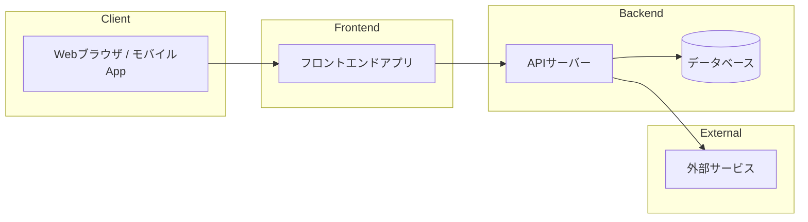

# アーキテクチャ設計

> 本ドキュメントは、本プロジェクトで採用するシステムアーキテクチャの全体像（主要コンポーネント・外部サービス連携・技術スタック）を、自社の開発チームおよびクライアント双方が正しく理解するためのものです。
> データベースの詳細設計は [`database.md`](./database.md)、API の詳細仕様は [`api-design/api-list.md`](./api-design/api-list.md) を参照してください。本ファイルはシステム全体の構成と技術選定の根拠に特化します。

## 1. 概要・設計方針

<!-- システムの全体像（モノリス/マイクロサービス、オンプレミス/クラウド等）と、設計上重視する方針（可用性・拡張性・セキュリティ・保守性など）を記載。非機能要件は ../02_requirements/non-function-list.md を参照 -->

- **アーキテクチャ方式:** [例: モノリシック構成 / マイクロサービス構成 / サーバーレス構成]
- **実行環境:** [例: AWS 上のコンテナ構成（ECS Fargate） / オンプレミス / ハイブリッド]
- **設計方針:**
  - [例: 将来のトラフィック増加に耐えられるよう水平スケール可能な構成にする]
  - [例: クライアントの既存システムとの連携を前提とし、認証は既存の IdP に統合する]

## 2. システム構成図

<!-- Mermaid 等でシステム全体の構成図（フロントエンド／バックエンド／データベース／外部サービスの関係）を記載 -->

## 3. 主要コンポーネント構成

<!-- 本プロジェクトで開発・運用する主要なシステムコンポーネントを記載。各コンポーネントの役割と、それを実現する主要技術スタックを明記する -->

| 区分 | コンポーネント名 | 概要・役割 | 主要技術スタック |
| --- | --- | --- | --- |
| フロントエンド | | <!-- 例: 利用者向け Web 画面。SPA として提供 --> | <!-- 例: React 18 / TypeScript / Vite --> |
| バックエンド・API | | <!-- 例: 業務ロジックを提供する REST API サーバー --> | <!-- 例: Node.js / NestJS / TypeScript --> |
| データベース | | <!-- 例: 業務データの永続化。詳細は database.md 参照 --> | <!-- 例: PostgreSQL 16 --> |
| バッチ・非同期処理 | | <!-- 例: 夜間集計、メール送信などの非同期ジョブ --> | <!-- 例: AWS Lambda / SQS --> |
| インフラ・実行環境 | | <!-- 例: 各コンポーネントのホスティング・コンテナ運用 --> | <!-- 例: AWS ECS Fargate / Terraform --> |
| CI/CD | | <!-- 例: ビルド・テスト・デプロイの自動化 --> | <!-- 例: GitHub Actions --> |

## 4. 外部サービス・サードパーティ連携

<!-- 自社で開発しない、外部の SaaS / API / サービスを記載。契約・料金プランが発生するものはクライアントとの合意事項として明記する -->

| サービス名 | 提供元 | 用途・概要 | 連携方式 | プラン・料金 |
| --- | --- | --- | --- | --- |
| | | <!-- 例: メール配信基盤として利用 --> | <!-- 例: REST API / SDK --> | <!-- 例: 従量課金プラン --> |
| | | <!-- 例: 決済処理基盤として利用 --> | <!-- 例: REST API / Webhook --> | <!-- 例: 決済額の X% --> |
| | | <!-- 例: 認証基盤（IdP）として利用 --> | <!-- 例: OAuth2.0 / SAML --> | <!-- 例: 月額固定プラン --> |

## 5. 技術スタック一覧（サマリ）

<!-- 3・4 で挙げた技術要素をレイヤー単位で総覧できるように整理し、選定理由を明記する。クライアントへの技術選定の説明資料としても利用できる -->

| レイヤー | 技術・製品 | バージョン | 選定理由 |
| --- | --- | --- | --- |
| フロントエンド | | | <!-- 例: チームの習熟度が高く、開発速度を優先 --> |
| バックエンド | | | |
| データベース | | | |
| インフラ・クラウド | | | |
| 認証・認可 | | | |
| 監視・ログ | | | |

## 6. 制約条件・前提条件

<!-- 技術的制約（既存システムとの互換性、クライアント側で指定された技術・ベンダー等）、予算・リソースの制約、外部システム連携の前提条件を記載 -->

-

## 7. 改訂履歴

| 日付 | 更新者 | 内容 |
| --- | --- | --- |
| | | |
