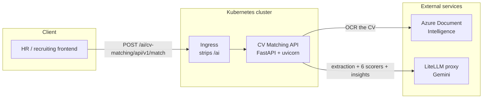

# Architecture

> System architecture for the CV Matching service: components, external integrations, and the
> reasoning behind the technology choices. API details live in
> [`api-design/api-list.md`](./api-design/api-list.md). This service holds no database — see
> [`database.md`](./database.md).

## 1. Overview and design principles

- **Architecture style:** Single containerised REST API service (extracted from a former monolith).
- **Runtime:** Kubernetes, image published to Harbor, deployed via the Helm chart in
  `deploy/charts/cv-matching`.
- **Design principles:**
  - **Clean architecture.** Business rules sit in `domain/`, free of FastAPI, Azure and LiteLLM. All
    external systems are reached through ports, so the OCR backend or the LLM provider can be swapped
    without touching scoring logic.
  - **Stateless.** No database and no session state; every request is self-contained. Scaling is
    horizontal, and any replica can serve any request.
  - **Explainable scoring.** Each criterion returns its own score, weight and written justification.
    The API never returns a total it cannot account for.
  - **Degrade rather than fail.** The narrative insights call is allowed to fail into a warning,
    because the scores it summarises are already computed and are the substance of the report. A
    criterion scoring failure is *not* degraded — Skills alone carries 40%, so a silent 0 would read
    as a genuine rejection.

## 2. System diagram

## 3. Components

| Category | Component | Role | Technology |
| --- | --- | --- | --- |
| API | CV Matching API | Extracts CVs and scores them against a JD | Python 3.13 / FastAPI / uvicorn |
| Domain | Criterion scorers | Six independent prompt-based scorers | Pydantic structured output |
| Domain | Resume profile | Pure functions: experience arithmetic, prompt rendering | Python stdlib |
| Infrastructure | Document parser adapter | CV file → plain text | Azure Document Intelligence SDK |
| Infrastructure | LLM adapter | Structured output calls | langchain-openai → LiteLLM |
| Infrastructure | DI container | Wires ports to adapters | dependency-injector |
| Observability | Metrics | Prometheus scrape endpoint | prometheus-client |
| CI/CD | Build and publish | Image to Harbor, chart to OCI registry | GitHub Actions / docker bake / Helm |

There is **no database and no batch processing.** Every request is synchronous and self-contained.

## 4. External services

| Service | Provider | Purpose | Integration | Notes |
| --- | --- | --- | --- | --- |
| Document Intelligence | Microsoft Azure | OCR of PDF / DOCX / image CVs (`prebuilt-read`) | REST via SDK | Consumption billing; region defaults to `japaneast` |
| LiteLLM proxy | Sun\* internal (`llm.sun-asterisk.ai`) | Extraction, 6 criterion scorers, insights | OpenAI-compatible REST | Behind Cloudflare with a 120s read timeout |

**Per request:** 1 Azure DI call, then 1 extraction call, then 6 concurrent scoring calls, then 1
insights call — 8 LLM calls total for a full match. A request without `jd_text` makes only 1.

## 5. Technology choices

| Layer | Technology | Version | Why |
| --- | --- | --- | --- |
| Language | Python | 3.13 | Matches the team's other AI services; ecosystem for LLM/document tooling |
| Web framework | FastAPI | 0.115+ | Async, and generates the OpenAPI contract the frontend consumes |
| Validation | Pydantic | v2 | The same models validate the API and act as the LLM structured-output schema, so the two can never drift |
| DI | dependency-injector | 4.42+ | Keeps adapters out of the domain and makes the use case testable with fakes |
| OCR | Azure Document Intelligence | 1.0.2+ | Reads PDF, DOCX and images directly, so no conversion step is needed |
| LLM access | langchain-openai | 1.1.7+ | `with_structured_output` maps responses onto Pydantic models |
| Model | gemini-3.1-flash-lite-preview | — | Only model of six benchmarked that reproduces a score exactly on re-run; 3× faster at p50, 15× at p90 than gemini-3-flash-preview |
| Packaging | uv + hatchling | — | Fast, reproducible container builds |

## 6. Constraints and assumptions

- Azure Document Intelligence and LiteLLM credentials must be provisioned before deployment; the
  service validates them at startup and refuses to start without them.
- The LiteLLM proxy sits behind a 120s Cloudflare read timeout. The client timeout is deliberately set
  to 90s so a slow call fails as our timeout — which the retry logic can act on — rather than an
  opaque 524.
- The Azure SDK is synchronous; OCR runs on a worker thread so it cannot block the event loop.
- Uploaded CVs are written to a temporary file, read once, and deleted in a background task after the
  response is sent. Nothing is persisted.
- Requests are authenticated with a single shared API key (`X-API-Key`), compared in constant time.
  There is no per-user identity in this service.

## 7. Revision history

| Date | Author | Change |
| --- | --- | --- |
| 2026-08-19 | Le Duc Viet | Initial version, extracted from the `ai_erp_backend` monorepo |
