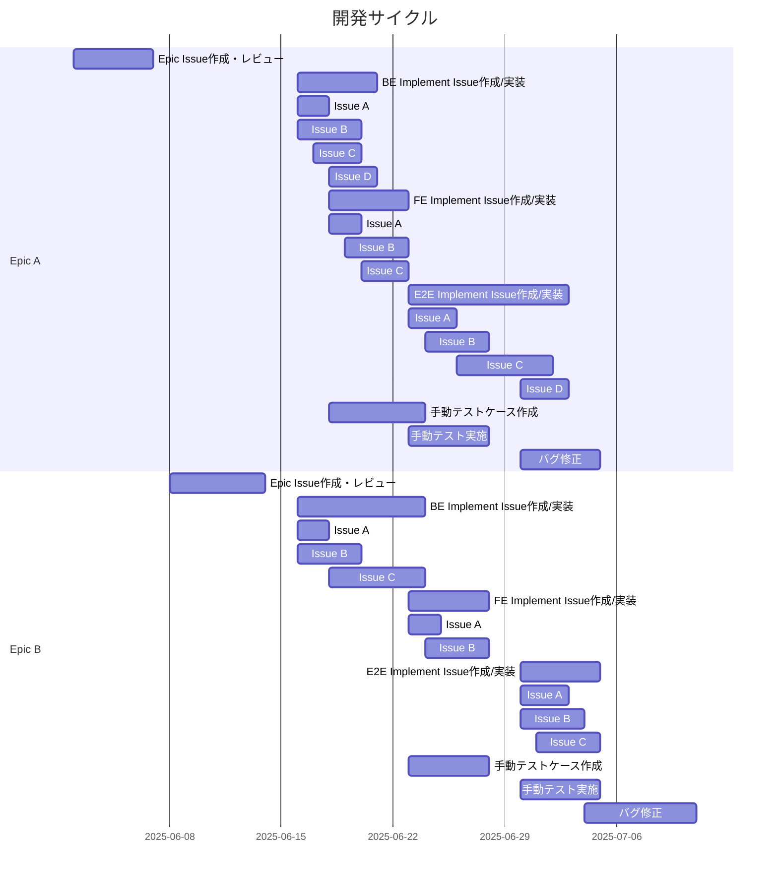

# 目次
1. はじめに
    1. 本書の位置付け
    2. 本書の流れ
2. AI駆動開発とは
    1. AI駆動開発の概要
    2. 設計・実装プロセス
        1. 全体像
        2. 設計・実装プロセスを実現するためのテンプレート
        3. 基本設計
        4. 詳細設計
        5. 実装
        6. コードレビュー
    3. テスト戦略
        1. 全体像
        2. 単体テスト
        3. 結合テスト
        4. システムテスト・受入テスト
    4. 見積もり
3. AI駆動開発におけるプロジェクト管理・推進方法
    1. AI駆動開発におけるプロジェクト管理・推進の概要
    2. 開発サイクル・スケジューリング
    3. 進捗管理
        1. 管理方針
        2. 使用ツール
    4. 仕様管理
    5. 課題管理
    6. 品質管理
4. プロジェクト進行における勘所
    1. 人間の思考・作業・会話が介在する部分がボトルネックになる
    2. AIは決して魔法ではないので期待値調整がより一層大事になる
    3. 必ずAIの作業が早い、というわけではない
    4. 開発生産性が上がってもQCDSのトレードオフはなくならない
    5. 要件や仕様の言語化を厳格にしないといけない

# 1. はじめに
## 1-1. 本書の位置付け
本書では、AI駆動開発におけるプロジェクトのプロセスと、その中でのPMの立ち回りについて記載しています。
本書を読むことで、AI駆動開発を活用したプロジェクト推進ができるイメージを持っていただければと思います。

## 1-2. 本書の流れ
目次にある通り、本書では
1. AI駆動開発そのものの説明
2. AI駆動開発のプロジェクトをどう推進するかの説明（Howの部分）
3. プロジェクト推進する上で気をつけるべき観点の共有

という流れで、AI駆動開発のオンボーディングを進めます。

# 2. AI駆動開発とは

## 本章で登場する主なツール・用語
本章ではAI駆動開発特有のツールや用語が登場するため、先に一覧で紹介します。

| 用語 | 説明 |
|------|------|
| バイブコーディング（Vibe Coding） | AIに自然言語で指示を出し、コードを生成させる開発手法。細かい実装指示をせず、AIに「良い感じに」任せるスタイル |
| Claude Code | Anthropic社が提供する対話型AIコーディングアシスタント。自然言語での指示に基づいてコードを生成・編集する |
| MCP（Model Context Protocol） | AIがGitHubなどの外部システムの情報を参照・操作できるようにするプロトコル |
| Serena | プロジェクトのコードベースや設計情報をキャッシュし、AIが効率的に参照できるようにするツール |
| Claudeコマンド | Claude Codeに特定の作業を実行させるためのコマンド。Implement Issue作成や実装などの定型作業を効率化する |

## 2-1. AI駆動開発の概要
Sun*におけるAI駆動開発では、単にバイブコーディングで実装をAIに任せるだけでなく、実装の手前にある設計や、実装の後にあるテストを含めて開発プロセス全体の効率化・高品質化を目指します。 Sun\* AI Ready SDLC(Software Development LifeCycle)とも呼称します。

2026年2月時点では、詳細設計・実装・単体テスト・一部の結合テストを人間ではなくAI（主にClaude Code）に作業してもらうプロセスを構築できています。
作業主体はAIになりますが、品質担保の目的でプロセスの中に人間は引き続き介在し続けます。
- 人間による前提の整理とAIへのインプット
- 人間による成果物レビュー・テスト

をもって、作業効率と担保すべき品質のバランスを取ります。

エンジニア向けですが、AI駆動開発の詳細について知りたい方は以下のリンクを参照ください。
https://ai-driven-development.sun-asterisk.com/

上記の通り、2026年2月時点では、要件定義・基本設計・システムテスト・受入テストはAIによって代替されません。
※もちろん個別の作業をAIによって効率化することはできますが、現状は各人の努力によってなされているものであり、プロセスとして体系化はできていません。
したがって、仮にソフトウェア開発データ白書2018-2019 (*1) が提示する工数比率を正とする場合、詳細設計が約17％・実装が約23％を占めます。つまり、開発プロセス全体のうちの40％のみがAI駆動開発によって代替され、効率化の対象になります。
すなわち、仮にAI駆動開発によって代替されたプロセスの効率が2倍になったとしても、開発プロセス全体のうちの25％しか効率化されていない、ということになります。
プロジェクト進行における勘所 章にて改めて言及しますが、「AIを使うことで、2年がかりで要件定義からやらないといけないプロジェクトが3ヶ月で終わるぞ！」みたいなことは決してないので、ご認識をお願いします。

(*1) https://www.ipa.go.jp/archive/publish/wp-sd/download.html

## 2-2. 設計・実装プロセス
### 2-2-1. 全体像
プロセスの全体像は以下の通りです。
1. Epic Issue作成: V字開発モデルでいうところの基本設計の一部
2. Implement Issue作成: V字開発モデルでいうところの詳細設計に近いところ
3. 実装
4. 単体テスト

Epic IssueとImplement Issueの関係性を図で示すと以下のようになります。

```
[機能要件]
    ↓
[Epic Issue] ← 画面・機能単位（基本設計レベル）
    │           例：「ユーザー登録画面の実装」
    ↓
[Implement Issue] × n個 ← 実装タスク単位（詳細設計レベル）
    │                      例：「登録フォームのバリデーション実装」
    │                          「登録APIの実装」
    ↓
[実装・単体テスト]
```

### 2-2-2. 設計・実装プロセスを実現するためのテンプレート
設計・実装プロセスを実現するために、Claudeに読ませるコマンドやコンテキスト情報をまとめたテンプレートの存在があるので、各プロセスの詳細に入る前に共有します。
リンク: https://github.com/sun-asterisk-internal/sun-ai-ready-sdlc

テンプレートの中には以下が含まれます。
- GitHub Issue テンプレート: 設計、実装、バグレポートなど、フェーズごとに最適化されたテンプレート
- GitHub Workflow テンプレート: Claude Code統合、コードレビュー自動化、セキュリティチェックなど
- Claude: 開発を支援するための実装コマンドやイシュー作成コマンド
- Serena: プロジェクトコンテキスト情報のキャッシュ

### 2-2-3. 基本設計
基本設計フェーズでは「Epic Issue」という成果物を出すことを目標とします。Epic Issueとは、画面設計・画面遷移・テーブル設計といった基本設計レベルの内容が記載されたドキュメントで、画面単位か機能単位で作成します。
[サンプルのリンクはこちら](./epic-issue-sample.md)

基本設計フェーズで作成する画面設計書やAPI設計書、テーブル設計書をAIに作成してもらうための体系的な仕組みはないですが（2026年2月時点）、Epic Issueを作成するコマンドはあります。コマンドだけで完璧なEpic Issueは作成できないものの、叩きレベルのものは出してくれます。

MoMorphを活用して、基本設計の効率化をすることもできます。MoMorphから画面仕様をGithub Issueに吐き出すことができ、これをEpic Issueとして使うこともできます。
[サンプルのリンクはこちら](./epic-issue-by-momorph-sample.md)

### 2-2-4. 詳細設計
詳細設計フェーズでは「Implement Issue」という成果物を出すことを目標とします。Implement Issueとは、Class設計やインターフェース設計など、詳細設計レベルの内容が記載されたドキュメントです。Epic Issueに記載された機能や画面を実現するために必要な実装タスクごとに作成します。
[サンプルのリンクはこちら](./imple-issue-sample.md)

つまり、
- Epic Issue: 画面・機能の粒度で、特定のユーザーストーリーを実現するためのチケット
- Implement Issue: 実装タスクの粒度で、Epic Issueで実現したいユーザーストーリーを達成するためのチケット

という棲み分けです。

Implement Issueは、必要なコンテキスト（Epic Issueやその他必要な資料）を渡しつつ、Claudeコマンドを使って作成します。
/sun-ai-ready-sdlc/templates/web-development/.claude/commands/generate-impl-backend.md

当然ですが、1回の依頼で完璧な成果物を出すことはなく、AIとの対話を繰り返して成果物をブラッシュアップしていきます。

### 2-2-5. 実装
実装フェーズでは、ソースコードを成果物として出すことを目標とします。Implement Issueの内容をもとに必要なソースコードを生成し、Pull Requestを出します。
ソースコードは、Implement Issueをコンテキストとして渡して、Claudeコマンドを使って作成します。

こちらも当然ですが、1回の依頼で完璧な成果物を出すことはなく、AIとの対話を繰り返して成果物をブラッシュアップしていきます。

### 2-2-6. コードレビュー
Pull Requestが出た後は通常の開発と同じくコードレビューを実施します。ただ、コードレビューもAIを活用して実施します。
// TODO コードレビューコマンドのリンクを貼る

AIが驚くべきスピードでコードを生成するので、どこまで人間の目でコードレビューするかは検討が必要です。
仮に全てを人間が見る場合、レビュースピードが開発スピードの限界値になってしまいます。開発スピードを優先度として下げられる場合はこれでも良いですが、仮にスピードを重視する場合、テストコードのみ人間が見てプロダクションコードはAIレビューのみにする、など割り切りも必要です。

## 2-3. テスト戦略
### 2-3-1. 全体像
AI駆動開発におけるテストの全体像は以下のとおりです。

| テストフェーズ | テスト実施主体 | 成果物 |
| --- | --- | --- |
| 単体テスト | AI | 単体テストコード |
| 結合テスト | AIと人間の両方 | - E2Eテストコード<br>- 機能テストのテスト仕様書 |
| システムテスト | 人間 | システムテストで実施するテストの仕様書(*1) |
| 受入テスト | 人間 | 受入テストで実施するテストの仕様書 |

(*1) プロジェクトによって実施するシステムテストフェーズのテストは異なりますが、負荷テスト・シナリオテストのようなものをイメージしてください

AI駆動開発だからと言って特殊なことはしておらず、既存のテストプロセスにおける一部の作業がAIに代替されるものと思ってください。

### 2-3-2. 単体テスト
単体テストは基本的にテストコードによって実施します。実装のタイミングでまとめてテストコードもAIに出してもらいます。
テストのスコープはFE・BEともに以下の通りで、手でコードを書く場合のテストコードと特段変わる部分はありません。
- FE
    - 実装したロジックが問題なく動いているか
- BE
    - 実装したコードロジックが問題なく動いているか
    - 実装したエンドポイントのリクエスト・レスポンスパラメーターが想定通りか

### 2-3-3. 結合テスト
結合テストでは、
1. Playwrightなどのツールを使った、自動化されたE2Eテスト
2. 人間によるテストケース作成・実施

を実施します。E2Eについては実装タスクと同じく、テストコードの計画と実際のテストコード作成をAIに実施してもらいます。
結合テストでは、基本設計で定義した内容（＝UIや画面の振る舞い）を確認しますが、全部をE2Eで実施するのは工数がかなりかかるので、E2Eテストと人間によるテストの役割分担を明確にしましょう。たとえば以下のようなイメージです。
- E2E
    - デグレ防止の観点で、フロントロジック・データ受け渡し部分の正常系・準正常系ケースを確認（機能追加後にE2Eを回してデグレ検知に役立てる）
- 人間によるテスト
    - UIがデザイン通りに実装されているか
    - フロントのバリデーションが仕様通りに実装されているか
    - FEとBEの繋ぎ込み部分（リクエストとレスポンスのやり取りの部分）がうまく動作しているか

### 2-3-4. システムテスト・受入テスト
2026年2月時点では、システムテスト・受入テストのプロセスは通常のプロジェクトと変わりません。テストケース作成やデータ集計などにAIを使用することはあるかもしれないですが、体系だった理論はないです。

## 2-4. 見積もり
2026年2月時点では、AI駆動開発における工数見積もり手法は確立していません。ただ、以下のような考え方で見積もりをした事例があるので参考にしてみてください。
- 想定されるImplement Issueの数で見積もりを実施する（概算見積もり）
    - 平均化すると、1つのImplement Issue作成と実装にそれぞれ5時間ほどかかるため、その前提で実装工数を積み上げる
    - テスト工数は実装工数に対して係数をかける
- 想定されるImplement Issueに対して重みづけをし、過去の実装実績をもとに工数を算出する
    - Difficulty（技術的複雑度）× Scope（作業量）の2軸で重みづけをする
    - 同じプロジェクトの過去のチケットを参照し、重みごとにチケットの消化時間目安を算出しておく
    - 重みによって実装工数が自動算出される

# 3. AI駆動開発におけるプロジェクト管理・推進方法
## 3-1. AI駆動開発におけるプロジェクト管理・推進の概要
AI駆動開発で詳細設計と実装が効率化されたとはいえ、プロジェクトの管理・推進の原則は変わりません。これまで通り、進捗や仕様、課題を管理し、必要に応じて顧客と調整をしていく必要があります。
ただ、今までの開発とはスピード感や作業のプロセスが異なるため、管理・推進面で迷いが生じるかもしれません。したがってこの章では、AI駆動開発におけるプロジェクトの管理・推進方法について説明します。
プロジェクトによってはここに書いていることがベストプラクティスではないかもしれませんが、あくまで一つの考え方として認識いただくことを期待します。

## 3-2. 開発サイクル・スケジューリング
AI駆動開発における開発サイクルの考え方は、基本的にイテレーション開発と変わりません。特定の単位（例：2週間）でスプリントを切り、チームのベロシティと各タスクの見積もりを踏まえ、そのスプリントの中で実施するタスクを定義するイメージです。AI駆動開発での、スプリント内で実施するタスクは以下が存在します。
- Epic Issue作成・レビュー
- BE Implement Issue作成/実装 *Implement Issue作成と実装はまとめて実施します
- FE Implement Issue作成/実装
- E2E Implement Issue作成/実装
- 手動テストケース作成
- 手動テスト実施
- バグ修正

例えば、1スプリント＝2週間の前提でスケジュールを書き出すと、以下のような形になります。


仮に
- 2025-06-01~2025-06-14: スプリント1
- 2025-06-15~2025-06-28: スプリント2
- 2025-06-29~2025-07-12: スプリント3

とした時に、
- Epic A
    - スプリント1: Epic Issue作成・レビュー
    - スプリント2: 実装とテスト実施
    - スプリント3: テスト実施とバグ修正
- Epic B
    - スプリント1: Epic Issue作成・レビュー
    - スプリント2: 実装
    - スプリント3: テスト実施とバグ修正

をする、といったスケジュールですね。
これまでと開発サイクルやスケジュールの考え方で大きく変わる部分はないですが、AIがタスクを同時に進められるため、複数のタスクのスケジュールが重複することになります。このようにスケジュールが整理されるということは意識しておきましょう。

## 3-3. 進捗管理
### 3-3-1. 管理方針
3-2でも触れましたが、チームのベロシティとEpic Issueに紐づく各タスクの見積もりを踏まえ、どのスプリントでどのEpic Issueのどのタスクを実施するかを当てはめながらスケジュールを決めていきます。
したがって、スケジュールが整理されている＝開発期間の中で、どのタイミングでどのタスクを実施するのかが計画されているはずです。

その上で、木も見て森も見るために、以下2つの観点で進捗管理をします。
- 開発期間全体での進捗
- スプリント内の進捗

開発期間全体での進捗を見るには、バーンアップチャートがおすすめです。AI駆動開発では、手でコードを書くよりも各タスクが同時並行で進むこと圧倒的に多いです。したがって、各タスクのスケジュールだけを見ていても、全体が進捗しているかは判断し辛いため、バーンアップチャートで全体の進捗を表現するのをお勧めします。

スプリント内の進捗についても、各タスクのスケジュールと睨めっこするよりかは、各タスクの進捗を数値化し、スプリント内のタスクがどれくらい終わっているのかを表現することで進捗を判断するのが良いです。
各タスクに完了割合を入力してもらうことで進捗を数値化するのもいいですが、運用負荷が高いため、タスクのステータスを数値に置き換えてもいいでしょう。
AI駆動開発におけるタスクのステータスは以下の6個があります。
1. TODO
2. Implement Issue作成中
3. Implement Issueレビュー中
4. Implement Issue実装中
5. 実装レビュー中
6. 完了

プロジェクトによって指標は変わると思いますが、
1. TODO：0％完了
2. Implement Issue作成中：20％完了
3. Implement Issueレビュー中：40％完了
4. Implement Issue実装中：60％完了
5. 実装レビュー中：80％完了
6. 完了：100％完了

といった形でステータスごとの進度を定義することで、進捗の数値化ができます。
例えば特定のEpicのFEタスクとしてImplement Issueが3個あり、それぞれの見積もりとステータスが以下の場合

| タスク | 見積もり(相対値) | ステータス |
|----|----|----|
| Issue A | 3 | 実装レビュー中 |
| Issue B | 2 | Implement Issue実装中 |
| Issue C | 4 | Implement Issue作成中 |

FEタスクとしての進捗は　(3 * 0.8 + 2 * 0.6 + 4 * 0.2)/(3 + 2 + 4) = 4.4/9、つまり約49％になります。

なお、手動テストのケース作成・実行といった上記の考え方に当てはまらないタスクは、各タスクに完了割合を入力してもらうことで進捗を数値化しましょう。

### 3-3-2. 使用ツール
進捗管理のツールとして、GithubとGoogle Spreadsheetを使うことをお勧めします。
Githubは、各タスクのスケジュールやステータスを具に確認するために使用します。各チケットはGithub Issueに起こし、それをGithub Projectに紐づけて、一覧でタスクの状況を確認します。
//TODO Github Projectの雛形のリンクを貼る

なぜチケット管理をGithubで実施するかというと、ソースコードもGithubで管理することから、Pull RequestとIssueの紐付けが簡単なためです。
特別な仕組みの構築をすることなく、GithubMCPなどを使って実装のステータスを元に自動的にチケットのステータス変更もできるため、管理の手間が削減されます。

ただ、Github Projectのチケット集計機能が強くありません。したがって、Github Projectに紐づくIssueの内容をGoogle Spreadsheetに吐き出して、Google Spreadsheet上でバーンアップチャートやスプリントのダッシュボードを構築することを推奨します。
//TODO 進捗ダッシュボードの雛形のリンクを貼る

- チケット集計
    - 定期的にGithubの情報を取得して〇〇シートに出力するGASを組んでいます
- 全体の進捗を見るバーンアップチャート
    - チケットのステータスを元に、全体のスコープのうちどれくらい満たしているかを〇〇シートに反映します
    - そのシートの内容を元に、〇〇シートでバーンアップチャートが表現されます
- スプリント内の進捗を見るダッシュボード
    - チケットのステータスを元に、以下を〇〇シートに反映します
        - スプリント内で対応する各Epicの、タスク種別（FE・BE・E2E・手動テストなど）ごとの進捗
        - スプリント内のタスク全体と、タスク種別（FE・BE・E2E・手動テストなど）・メンバーごとの進捗

## 3-4. 仕様管理
プロジェクトの方針によるとは思いますが、AIに仕様をコンテキストとして渡すことを考えると、仕様管理も、進捗管理と同じくGithubを活用することをお勧めします。GithubのリポジトリにAPI設計やテーブル設計のドキュメントを格納したり、Github Issueとして作成したImplement Issueを作成するチケットにImplement Issueの内容を記載したりするといったイメージです。

Githubに仕様を格納すると、該当のリンクをAIに渡すだけでコンテキストを理解してくれるため、AIとの対話の効率が上がります。

## 3-5. 課題管理
課題管理は任意のツールを使ってください。ここは現状AI駆動開発によって変わる部分はないです。

## 3-6. 品質管理
テスト工程はこれまでの開発プロセスと変わりませんが、AIが超高速で大量のコードを生成することに鑑みて品質戦略を考えましょう。
具体的には以下のような観点です。
- ローカルでの動作確認やPRレビューに時間をかけすぎると速度が出ないので、いったん開発環境に入れてしまって結合テストでバグ出しする方が全体的なスピードは速い
    - 特にUIチェックはAIよりも人間の方が精度が高く、コストも低い
    -> 結合テストでプロダクトの品質を担保するようにする
- AIが生成したコードが膨大すぎて影響範囲を特定しきれない
    -> プロダクトを構成するロジックのデグレを検知できるように、全ロジックの単体テスト追加・更新を必ず実施するようにする

# 4. プロジェクト進行における勘所
## 4-1. 人間の思考・作業・会話が介在する部分がボトルネックになる
AIによってアウトプットが出る量が爆速になります。ただ、AIが作業する以外のプロセス（仕様確定のための議論・レビューなど）が遅れると、プロジェクト全体のベロシティはそれほどあがりません。
人間がコードを書いていた時代でも、仕様が決まらない・仕様がコロコロ変わるなどで待ち時間や手戻りが発生していましたが、AI駆動開発によってこれらが明確にボトルネックになります。

したがって、AIを使っているのに速度が出ない場合は、人間が原因となっている可能性も疑いましょう。

## 4-2. AIは決して魔法ではないので期待値調整がより一層大事になる
AIは決して魔法ではありません。今のAI駆動開発ではまだまだ人間が介在するプロセスが多く、効率化できている部分はごく一部です。
したがって、「AIを使うとなんかめっちゃ早くなるんでしょ！」みたいな人がいる場合は、期待値を正してあげることを強く推奨します。

雑な要件定義書を投げたらシステムが出来上がる世界を望みますが、その世界が来るのはもう少し先みたいです。

## 4-3. 必ずAIの作業が早い、というわけではない
AIは爆速でアウトプットを出してくれますが、静的テキストをちょこっと直すなどの瑣末な作業は人間がやった方が早いです。
AIにアウトプットを出してもらうことに執着せず、誰がアウトプットを出すのが最善かを常に考えるようにしましょう。

## 4-4. 開発生産性が上がってもQCDSのトレードオフはなくならない
AI駆動開発を使うことで確かに開発スピードは上がります。ただ、生産性が上がった前提でスケジュール・スコープ・品質基準を組むことになるので、結局QCDSの議論をすることになります。どこまでいってもプロジェクトマネージャーはQCDSをハンドリングする必要があることは理解しておいてください。

## 4-5. 要件や仕様の言語化を厳格にしないといけない
アウトプットの主体がAIになる以上、インプットの全てを正しく言語化する必要があります。AIに「良い感じにやっといて」は通用しません。些細なUI修正・テキスト修正であっても、AIへの明確な指示がないとアウトプットを出してくれないので、必ずインプットとなる要件や仕様は全てを言語化しましょう。

